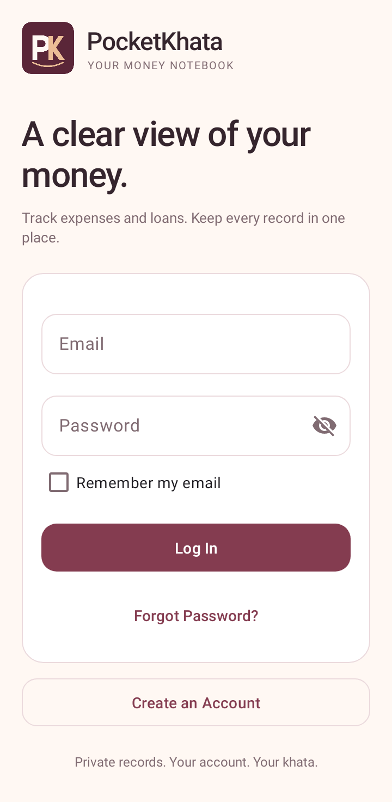
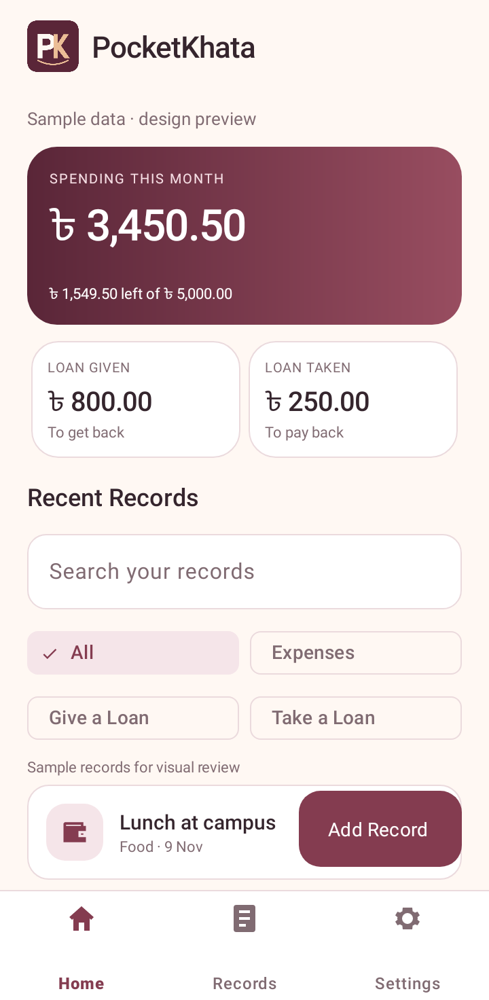

# PocketKhata — পকেটখাতা

A Java + XML Android app for personal expenses, money lent, and money borrowed. Built for Mobile Application and Development Lab (0613-410).

**[Download APK](https://raw.githubusercontent.com/MdAbuMusa1414/PocketKhata/main/distribution/PocketKhata-v1.2.apk) · [Release v1.2](https://github.com/MdAbuMusa1414/PocketKhata/releases/tag/v1.2)**

Repository owner: **MdAbuMusa1414**. Before submission, add your exact student name and student ID here; they have not been provided.

## Design and navigation

PocketKhata 1.2 uses an original **PK** monogram (Pocket + Khata) with a curved pocket edge, a maroon/cream palette, and a single Settings destination in the bottom navigation.

- **Home:** monthly spending, budget, unpaid-loan balances and five recent matching records.
- **Records:** the complete matching history, including expenses and both loan directions.
- **Settings:** budget, preferences, account and logout.

All / Expenses / Give a Loan / Take a Loan filters remain available. Updates use the same app ID, signing identity, Firebase structure and preference keys. The original APK-attached v1.0 Release remains available for the course requirement.

## Features

- Seven Activities: Splash, Login, Register, Home, Add/Edit, Entry Details, Settings. Home also provides a Records tab.
- Firebase Authentication: register, login, password reset, logout, persistent login.
- Private Firebase Realtime Database records under `users/{uid}/entries/{entryId}`, with live listeners.
- Create, view, edit and delete Expense, Lent and Borrowed entries.
- Confirm deletion and repayment changes with Material dialogs; create entries from the FAB.
- Search and filter a RecyclerView; settled-loan visibility preference.
- This month's spending, monthly budget progress, total outstanding lending and borrowing.
- Exact money calculations in integer paisa, not floating-point amounts.
- Camera capture and gallery/document photo selection, receipt preview, resizing and EXIF orientation correction.
- Open the dialer for a saved contact; share entries and summaries; open this GitHub project.
- SharedPreferences for remembered email, each user's local budget, and settled-loan visibility.
- Original PK monogram icon, Material 3 theme, Snackbar/Toast feedback, input validation.

## Run in Android Studio

1. Install a current Android Studio version supporting Android Gradle Plugin 8.7.3, with JDK 17 and Android SDK 35.
2. Open this directory (the one containing `settings.gradle`).
3. Let Gradle sync. The Gradle 8.9 wrapper is included.
4. `app/google-services.json` is already configured for `pocketkhata-musa`, package `com.pocketkhata.app`.
5. The database URL is in `app/src/main/res/values/strings.xml`. Email/Password Authentication must be enabled and the rules in `database.rules.json` must be published.
6. Run on an Android 8.0+ phone/emulator. The owner's phone is Android 12.
7. Choose **Create an account** on the login screen. There is no shared default password or pre-created demo login.

Command line: `./gradlew assembleDebug testDebugUnitTest lintDebug`. On Windows: `gradlew.bat assembleDebug testDebugUnitTest lintDebug`.

## APK and release

The installable version 1.0 APK is provided separately. `assembleRelease` generates an unsigned release APK; a separate owner-controlled signing key is required to sign updates. Never commit private signing material to this public repository.

The Firebase Android configuration contains public client identifiers, not an administrative service-account key. Database authorization is enforced by Firebase Authentication and the rules, not by hiding the client API key. Never add Firebase Admin credentials, account passwords, OTPs, or GitHub tokens to this repository.

## Before final submission

- Open the project and review/modify the code; understand the components for the viva.
- Push the supplied Git history to this public repository from Android Studio. The supplied Git history is preserved in this repository.
- Add your student name and ID above.
- Test on the actual phone using the checklist in `docs/PHONE-TEST-BN.md`.
- Create GitHub Release **v1.0** and attach the signed APK. Do not upload the private signing backup.
- Prepare the separate 10–15 page report when requested; no report is included yet.
- Keep the repository public after submission.

See `docs/REQUIREMENTS.md` for every requirement and `docs/ARCHITECTURE.md` for code and database details.

## Design previews

Rendered Android 12.1 layouts; dashboard uses labelled sample data, not the owner’s account.

 
