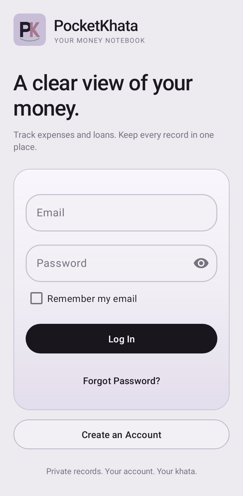
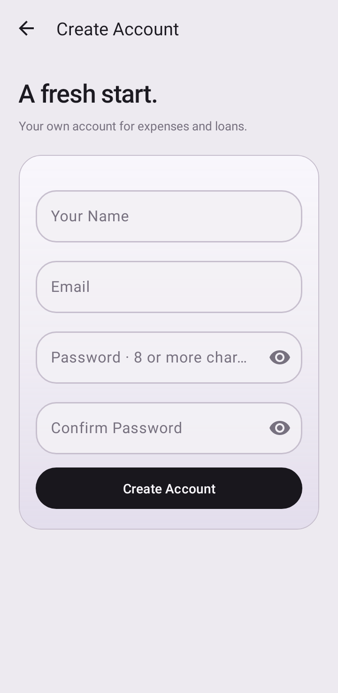
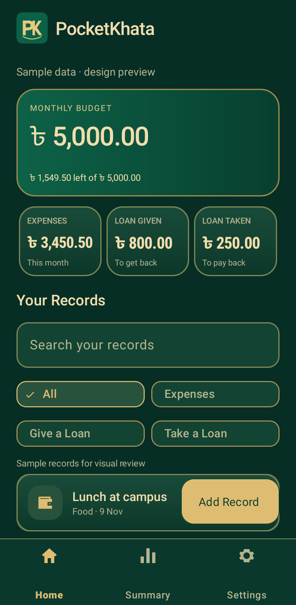
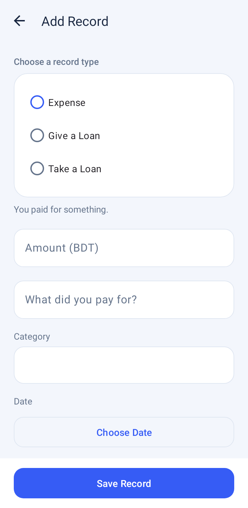
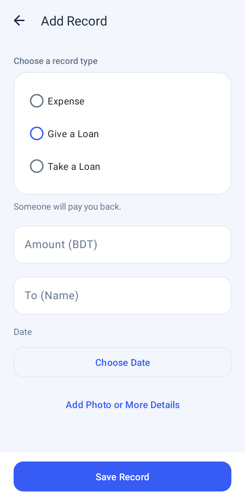
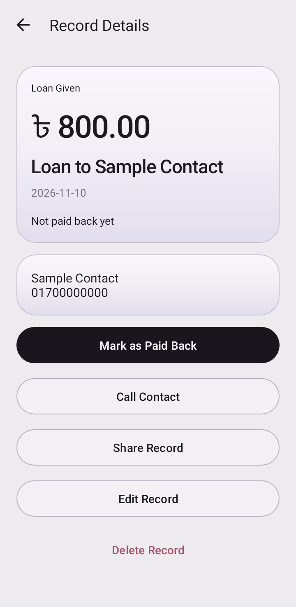
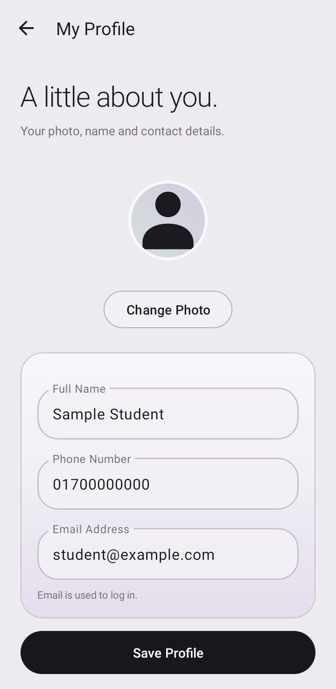
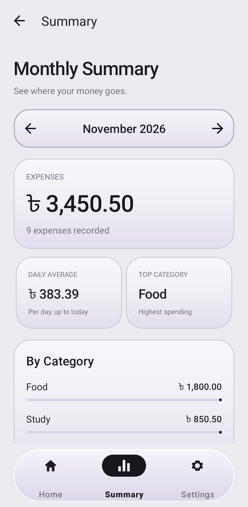
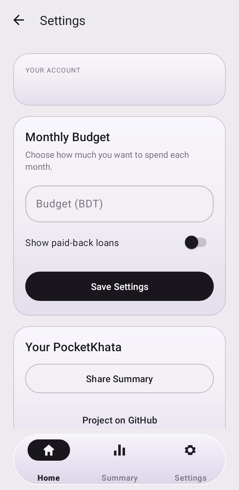

# PocketKhata — Final Lab Project Report

Abu Musa · Roll 27 · Batch E-109
Dhaka International University · Department of CSE

## Cover page

PocketKhata: Personal expenses and loan records

| Academic information | Details |
|---|---|
| Submitted by | Abu Musa |
| Roll / Batch | 27 / E-109 |
| Department | Computer Science and Engineering (CSE) |
| University | Dhaka International University |
| Course | Mobile App Development |
| Course code | 0613-410 |
| Submitted to | Ekramul Haque Amin |
| App / prepared date | PocketKhata 1.4 / 10 November 2026 |

Implementation: Java + XML · Firebase Authentication · Firebase Realtime Database

Application ID: com.pocketkhata.app | Android 8.0 and newer

## A private pocket ledger

Problem, objectives, scope and report guide

Small expenses and informal loans are easy to forget. A student may record food, transport and study costs in different places, then lose track of who still needs to return money. PocketKhata keeps these records in one Android app with a separate account for each user.

The app records three events: an Expense, money given to someone, and money taken from someone. It calculates monthly spending and outstanding loans, supports receipt/reference photos, and provides a monthly summary. It records information; it does not transfer money or operate a bank account.

### Project objectives

• Keep expense and loan records available after login and across devices through Firebase.

• Make creation, viewing, editing, deletion and repayment updates clear and validated.

• Separate spending from loans so the monthly budget and expense analysis remain meaningful.

• Use the required Android components for real tasks, including photos, local settings and implicit intents.

### Report guide

| Required section | Pages | Focus |
|---|---|---|
| Cover page | 1 | Student, course and instructor |
| Introduction | 2 | Problem, goals and scope |
| Features with screenshots | 3–5 | Accounts, records, analysis, settings and profile |
| Components, alternatives and reasons | 6–9 | Actual implementation components |
| Firebase database structure | 10 | Models, private paths and rules |
| GitHub link and workflow | 11 | Source, student commit and APK Releases |
| Problems faced and solutions | 12–13 | Fixes and verification evidence |
| Conclusion and references | 14 | Outcome, limits and official documentation |

## Accounts and Home

Figures 1–3: native Android 12.1 layout renders. The figures use sample data and are not photographs of the student’s phone.


Email/password sign-in, remembered email, account creation and password reset.


Name, email, password and confirmation are checked before Firebase registration.


Profile entry, budget, separate expense/loan totals, search, filters and navigation.

### Navigation and account behaviour

Splash routes an existing Firebase session to Home; otherwise it opens Login. Register creates the account and display name. Home opens Add/Edit, Details, Profile, Summary and Settings using Activities and explicit Intents. Logout returns to Login and clears the active navigation stack.

| Lab feature | How it is used |
|---|---|
| 1. At least five screens | Nine Activities: Splash, Login, Register, Home, Edit, Detail, Summary, Settings and Profile. |
| 2. Layouts and basic views | XML layouts combine text, images, buttons and cards for actual forms and record displays. |
| 5. Scrolling records | RecyclerView displays reusable record rows with the dashboard and empty state in one list. |
| 7. Firebase login | Register, sign in, sign out and persisted login state use Firebase Authentication. |

## Create, review and update

Figures 4–6: native UI renders with example values. No personal account records are reproduced.


Amount, purpose, category and date. Optional photo/contact/details are expandable.


Give a Loan asks “To (Name)”; Take a Loan asks “From (Name)”. Irrelevant fields are hidden.


Repayment, dialer, sharing, edit and delete actions for an illustrative loan record.

Save writes a new push-ID record or updates the selected record. Details receives entry_id through putExtra(), listens for changes and offers confirmation dialogs before deleting or changing repayment status. A paid loan stays in the data and can be marked unpaid again.

| Lab feature | How it is used |
|---|---|
| 3. Validated input | TextInputEditText.setError() identifies invalid fields. Empty purpose/person, invalid amounts and invalid phone formats are rejected. |
| 4. Model classes | Entry and UserProfile use no-argument constructors and getters/setters for Firebase mapping. |
| 6. CRUD, dialogs and FAB | The Extended FAB starts creation; Details supports viewing, editing, confirmation and deletion. |
| 10. Photo input | OpenDocument and TakePicture obtain an image; preview and saved-image views display it. |
| 11. Implicit intents | ACTION_DIAL opens a contact number; ACTION_SEND shares text; ACTION_VIEW opens the repository. |

## Summary, settings and profile

Figures 7–9: sample UI renders. Monetary fixtures illustrate the interface rather than the student’s actual balance.


Choose, capture or remove a photo; edit name/phone; view the login account email.


Change month; see expenses, count, daily average, highest category and category totals.


Save a local monthly budget and paid-loan preference; share, open GitHub or log out.

Only Expense records count toward monthly spending. The Home loan totals include unpaid loans from all months. Changing the visible filter does not redefine those totals. Summary excludes loans and groups expenses for its selected month.

| Worked example | Expected result |
|---|---|
| Budget BDT 5,000; one Expense BDT 125.50 | Monthly expenses = BDT 125.50; budget remaining = BDT 4,874.50. |
| Unpaid Loan Given BDT 800; Loan Taken BDT 250 | Outstanding given = BDT 800; taken = BDT 250. Neither is counted as an Expense. |
| 8. Realtime data / 9. Local setting | Firebase listeners refresh data; SharedPreferences keeps each account’s device-local budget and paid-loan visibility. |
| Additional requirements | Custom PocketKhata name/PK icon, matching Material theme, and Snackbar/Toast success/error feedback. |

## Implementation components 1/4

Each row identifies an actual component, its role and the reason for choosing it. Alternatives are comparisons, not claims of additional implemented features.

| Component / source | Use in PocketKhata and reason | Alternatives |
|---|---|---|
| Java and Android SDK
app/build.gradle | Java classes implement the app logic and XML defines screens. A native Java/XML project directly matches the lab tool requirement and uses platform lifecycle behaviour. | Kotlin; Flutter; React Native |
| AppCompatActivity; BaseActivity
Nine Activities; BaseActivity.java | Each screen has a clear responsibility. BaseActivity shares login routing, toolbar, error messages and inset handling, reducing repeated activity code. | Fragments; a single Activity; Compose |
| Explicit Intent; putExtra
HomeActivity; DetailActivity | Intents open named screens and pass entry_id or initial_type. Passing an ID keeps navigation small and lets the destination read the current Firebase record. | Navigation Component; shared in-memory state |
| Activity lifecycle; Bundle
onStart/onStop; saved instance state | Listeners attach and detach with screen visibility. Bundle state preserves selected dates, draft photo state and the Summary month across activity recreation. | ViewModel; SavedStateHandle |
| ConstraintLayout
activity_splash.xml | Constraints place the branding and loading information in the launch screen. They provide a stable centred layout without several nested positioning containers. | RelativeLayout; nested LinearLayout |
| LinearLayout; FrameLayout
Forms; dashboard; navigation holder | LinearLayout arranges fields and weighted rows; FrameLayout holds floating navigation. These containers keep the mostly vertical screen structure easy to read. | ConstraintLayout; RelativeLayout |
| CoordinatorLayout; Extended FAB
activity_home.xml | CoordinatorLayout hosts Home. An ExtendedFloatingActionButton clearly starts Add Record; its header position keeps it clear of filters and scrolling record content. | Plain Button; toolbar action; bottom sheet |
| NestedScrollView
Edit, Detail, Profile, Summary, Settings | Long forms and detail pages remain scrollable on a phone. NestedScrollView fits these small static pages while the record history uses RecyclerView. | ScrollView; paged forms; RecyclerView |
| TextView; ImageView; ImageButton
Labels, money, photos, month controls | Text views present labels and totals; image views show photos or icons. Image buttons give compact previous/next month actions with content descriptions. | Custom Canvas views; Compose controls |
| Material 3 theme; custom icon
themes.xml; ic_logo; launcher resources | A shared theme supplies colours, shape and typography. The PK vector and adaptive launcher use the same lavender, pink, mint and black identity. | Platform default theme; bitmap-only icons |
| WindowCompat; WindowInsetsCompat
BaseActivity.screen() | The root reserves system-bar and keyboard space once, then consumes the insets. This prevents the bottom bar from applying the same padding twice. | fitsSystemWindows; fixed screen padding |

## Implementation components 2/4

Each row identifies an actual component, its role and the reason for choosing it. Alternatives are comparisons, not claims of additional implemented features.

| Component / source | Use in PocketKhata and reason | Alternatives |
|---|---|---|
| RecyclerView
HomeActivity; activity_home.xml | RecyclerView efficiently reuses record-row views as the history scrolls. It supports adapter composition and predictable selection of individual records. | ListView; GridView; a large LinearLayout |
| Adapter; ViewHolder; LinearLayoutManager
EntryAdapter.java | The adapter binds Entry data to reusable rows and click actions. ViewHolder avoids repeated view lookup and LinearLayoutManager supplies a familiar vertical ledger. | ArrayAdapter; custom list rendering |
| ConcatAdapter; SingleViewAdapter
Home dashboard, rows and empty state | A header adapter, record adapter and empty adapter share one scrolling list. This avoids trapping the records below a large fixed dashboard. | Separate ScrollView and list; multiple row types |
| TextInputLayout; TextInputEditText
Login/Register/Edit/Profile forms | Outlined fields provide hints and contextual input types. setError() and field focus explain invalid input at the place where the user can correct it. | EditText; custom validation dialogs |
| Patterns and validation helpers
ProfileValidation; auth form checks | Email patterns, name checks and phone normalization stop invalid submissions. Small validation helpers keep rules readable and allow direct unit tests. | Server-only validation; custom regex everywhere |
| RadioGroup; MaterialRadioButton
EntryFormUi; EditActivity | One mutually exclusive choice selects Expense, Give a Loan or Take a Loan. Contextual binding shows the fields and helper text relevant to that choice. | Spinner; segmented buttons; separate forms |
| Spinner; ArrayAdapter
EditActivity category selection | The fixed category list uses a simple dropdown adapter. A controlled list makes later category grouping consistent and reduces spelling differences. | AutocompleteTextView; free text; chips |
| DatePickerDialog
EditActivity.pickDate() | A calendar supplies a valid LocalDate and limits future dates. This avoids asking the user to type and validate a date format manually. | Text date field; custom calendar |
| MaterialToolbar; MaterialButton
Toolbar and screen actions | Toolbars identify screens and offer back navigation; Material buttons provide consistent save and secondary actions. Shared styling keeps action hierarchy readable. | Platform ActionBar/Button; custom controls |
| MaterialCardView
Dashboard, forms and record details | Cards group related information with rounded borders and consistent padding. Visual grouping helps separate totals, entry facts and optional information. | Plain LinearLayout; custom drawable panels |
| Chip; DashboardFilters
Home type filters | Weighted two-column rows keep all four labels visible on narrow phones. A custom single-selection controller maps the selected chip to an internal record type. | TabLayout; horizontal scrolling chips |

## Implementation components 3/4

Each row identifies an actual component, its role and the reason for choosing it. Alternatives are comparisons, not claims of additional implemented features.

| Component / source | Use in PocketKhata and reason | Alternatives |
|---|---|---|
| BottomNavigationView; menu
Home / Summary / Settings | Three labelled destinations make the main screens accessible. Menu IDs route Activities and the middle Summary destination adds analysis rather than another All list. | Navigation drawer; tabs; gesture-only navigation |
| MaterialAlertDialogBuilder
DetailActivity confirmation actions | Delete and paid-back changes require a short confirmation. Showing the record context reduces accidental destructive or status changes. | Bottom sheet; separate confirmation Activity |
| Snackbar; Toast; progress views
BaseActivity; saves; budget indicator | Snackbar and Toast communicate success or failure; ProgressBar and LinearProgressIndicator show waiting or budget progress. Feedback follows the actual operation result. | Dialogs for every event; silent state changes |
| Firebase Authentication
FirebaseAuth; FirebaseUser | Managed email/password registration, login, reset and session persistence identify users. This removes the need to build and store a custom password database. | Own login server; phone OTP; Google Sign-In |
| Realtime Database; ValueEventListener
Repository; ProfileStore; Details | Private cloud paths store records and profile metadata. Realtime listeners refresh screens after changes without requiring a manual reload button. | Cloud Firestore; Room/SQLite; a REST server |
| PocketApp; disk cache; connectivity
FirebaseDatabase initialization | Persistence enables cached reads after data was accessed. The .info/connected listener gates entry/profile saves and reports connection state to the UI. | Network-only reads; a separate Room cache |
| Repository; ProfileStore
UID-scoped database access classes | These classes centralize paths and listener/write operations. Activities focus on form and screen behaviour instead of rebuilding Firebase references in each action. | Database calls inside every Activity; MVVM repository |
| Entry; UserProfile models
No-arg constructor; getters/setters | Firebase maps Java properties to data. Entry excludes its derived ID/isLoan values from serialization, keeping the key and computed state separate from stored fields. | Maps/JSON only; immutable DTOs with custom mapping |
| SharedPreferences; Prefs
Per-UID budget and local preferences | A few scalar settings are saved in private local files. Using the UID in the preferences name keeps one account’s local budget separate from another account. | DataStore; Room; plain text files |
| Activity Result APIs
OpenDocument; TakePicture launchers | The lifecycle-aware contracts return a chosen document URI or a camera result. They delegate capture/selection to installed apps rather than building a camera interface. | Legacy startActivityForResult; CameraX |
| FileProvider; content URI
Cached camera image in receipts folder | FileProvider grants scoped access to the temporary image destination. A content URI avoids exposing unrestricted file paths to the external camera app. | MediaStore insertion; custom camera storage |

## Implementation components 4/4

Each row identifies an actual component, its role and the reason for choosing it. Alternatives are comparisons, not claims of additional implemented features.

| Component / source | Use in PocketKhata and reason | Alternatives |
|---|---|---|
| BitmapFactory; ExifInterface; Base64
Photos.java | Sampled decoding, orientation correction and JPEG resizing keep image uploads small. Base64 fits the existing small-project database design without a new storage service. | Cloud Storage URLs; full-size bitmaps; image loaders |
| ExecutorService; Handler; UI thread
Photo work; delayed save feedback | Image processing runs off the UI thread and results return to the screen thread. Workers/listeners are cleaned up to avoid unnecessary activity work after closing. | Coroutines; WorkManager; synchronous decoding |
| ShapeableImageView; ProfilePhotos
Profile photo and Home avatar | Circular image clipping and a placeholder keep avatars consistent. The shared binding helper correctly switches between a saved image and an empty/invalid photo. | Plain ImageView; custom circle drawing |
| Implicit Intents; Uri; chooser
ACTION_DIAL / ACTION_SEND / ACTION_VIEW | The user chooses a dialer, sharing destination or browser. Existing phone apps perform these tasks while PocketKhata supplies only the relevant number or text. | Direct call permission; custom messaging/browser UI |
| BigDecimal; integer paisa
Money.java | Decimal parsing converts BDT to long paisa exactly and rejects invalid amounts. Integer addition avoids binary floating-point rounding errors in totals. | float/double; storing formatted money strings |
| LocalDate; YearMonth
Entry dates and monthly grouping | ISO dates and YearMonth define which expense belongs to a month. Java time APIs handle month lengths and keep display formatting separate from stored values. | Calendar/Date; manual string slicing |
| Summary; MonthlyBreakdown; LedgerRecords
Totals, category grouping and filtering | Separate Java helpers calculate outstanding loans, month-only expenses and filters. This makes the rules independently testable instead of hiding them inside view code. | SQL aggregates; calculation inside every Activity |
| Gradle; AGP; google-services plugin
Gradle 8.9; AGP 8.7.3; SDK 35 | The wrapper pins a repeatable toolchain and the plugin wires Firebase client resources. A checksum verifies the official Gradle download used by the setup helper. | Manual Java builds; Maven; unpinned tools |
| JUnit; Robolectric; Android lint
Unit tests and native screen renders | Tests check money, auth, photos, layouts and navigation; lint checks Android project issues. Native renders produce labelled report figures without exposing personal records. | Espresso/device tests; manual-only checks |
| Git; GitHub; APK signing tools
Public history, Releases, zipalign/apksigner | Git records changes; GitHub hosts source and APK Releases. Stable signing identity and package ID allow updates over the installed app with its data retained. | GitLab/Bitbucket; unsigned APK handover |
| MaterialCheckBox; SwitchMaterial
Remember email; show paid-back loans | These controls represent independent saved preferences. They provide visible checked/on states and use the local preference layer rather than changing remote records. | Plain CheckBox/Switch; custom toggle views |

## Private data under the signed-in UID

Firebase project: pocketkhata-musa · Realtime Database location: Singapore (asia-southeast1)

Firebase Authentication owns the account UID, login email and password operations. Repository and ProfileStore derive the path from the current FirebaseAuth user. A user never enters another user’s UID to choose a database path.

```text
users
  {auth-uid}
    profile
      name: "Sample Student"
      phone: ""
      photo: "base64 JPEG or empty string"
      updatedAt: epoch milliseconds
    entries
      {push-id}
        title: "Lunch"
        type: "Expense" | "Lent" | "Borrowed"
        amountPaisa: 12550
        category: "Food"
        date: "2026-11-10"
        person: ""
        phone: ""
        note: "Sample entry"
        photo: "base64 JPEG or empty string"
        settled: false
        createdAt: epoch milliseconds
        updatedAt: epoch milliseconds
```

### Authorization and update flow

```text
Root: .read = false, .write = false
users/$uid:
  .read  = auth != null && auth.uid === $uid
  .write = auth != null && auth.uid === $uid
```

A new record gets a Firebase push key. setValue() creates or replaces the model; removeValue() deletes it; updateChildren() changes repayment status and updatedAt. ValueEventListener maps snapshots back to Entry objects and updates the list or Details. Success messages follow the completion callback.

Entry.id is the snapshot key and is excluded from the stored object. The derived isLoan property is also excluded. Login email is read from FirebaseAuth rather than duplicated in profile. Budget and show-paid settings remain local; they are not database fields.

### Image and offline behaviour

Photos have a maximum dimension of 900 pixels and JPEG data of at most 125,000 bytes before Base64 encoding. Cached records can be read offline after being accessed. Entry/profile saves require connectivity at submission; a connection lost during a write can delay acknowledgement. Server rules enforce UID ownership; field-format checks are currently performed by the app.

## Public source and installable releases

Repository owner: MdAbuMusa1414 · The repository remains public for assessment.

https://github.com/MdAbuMusa1414/PocketKhata

The repository contains Java/XML source, the Gradle wrapper, Firebase client configuration, database rules, README, requirement mapping, test notes and signed APK distribution files. Private signing material is kept outside the repository.

### Student’s Android Studio commit

Abu Musa cloned and opened the repository in Android Studio, completed Gradle sync, edited README with student/course information, configured the Git author identity, committed the change and authenticated the JetBrains GitHub integration. The change was pushed from the IDE and verified on GitHub.

| Evidence | Recorded value |
|---|---|
| Student commit | 668cf915 — Add student and course information to README |
| Author / GitHub account | Abu Musa / MdAbuMusa1414 |
| Integration commit | c80027e9 — Merge remote-tracking branch origin/main |
| Earlier work | Actual source stages and releases were published through the authorized command-line workflow; the later student commit was made from Android Studio. |

### APK Releases

https://github.com/MdAbuMusa1414/PocketKhata/releases/tag/v1.0
https://github.com/MdAbuMusa1414/PocketKhata/releases/tag/v1.4

The course v1.0 Release also supplies the clearly labelled current v1.4 APK and this report. Its original tag and APK are retained as development history.

The current app is versionName 1.4, versionCode 7, package com.pocketkhata.app. Its release APK is zip-aligned and verifies with APK Signature Schemes v2 and v3. Keeping the signing certificate and package ID supports an in-place Update.

### Reproduce the project

Open the Gradle project in Android Studio, use Android SDK 35 and a compatible JDK, and let sync finish. Java source compatibility is 17; the release build used JDK 17, and the student’s Windows Gradle/configuration/sync checks succeeded with bundled JBR 21.0.10. Firebase Email/Password must be enabled and the UID rules published.

```text
Windows: gradlew.bat testDebugUnitTest lintDebug assembleDebug
Linux:   ./gradlew testDebugUnitTest lintDebug assembleDebug
```

A debug build has its own signing identity. The published signed release APK is the artifact used for updates on the student’s phone. A release assembled from source needs the project signing key before distribution.

## Changes based on observed problems

Design iterations and technical fixes are tied to actual project behaviour.

| Problem | Solution and practical result |
|---|---|
| Unclear loan terms and crowded inputs | The UI now uses Give a Loan, Take a Loan, Loan Given and Loan Taken. EntryFormUi shows purpose/category for expenses and To/From name for loans. Optional contact/photo/details start collapsed. |
| Missing loan filters on narrow screens | The four Home filters use two weighted rows rather than relying on a wide horizontal row. Regression checks verify visibility and readable Give/Take labels. |
| Bottom navigation labels clipped on the phone | The root had applied system insets and forwarded them so Material navigation applied space again. BaseActivity now consumes the handled insets; tests exercise different bottom inset sizes. |
| Add action covering records or controls | The Extended FAB was moved to the Home header. Scrolling and empty-state checks verify that the action stays clear of record content and navigation. |
| Money rounding and mixing loans with spending | Amounts use BigDecimal parsing and long paisa. Summary separates monthly Expense values from all outstanding loans; MonthlyBreakdown excludes loans and rounds average to paisa. |
| Large or rotated selected images | Photos uses sampled decoding, EXIF correction, resizing and bounded JPEG compression on a worker thread. Invalid/unsupported images produce feedback instead of a decoder crash. |
| Account privacy and stale screen subscriptions | UID-scoped paths and rules separate accounts. Activities remove realtime listeners when stopping, while completion callbacks and connection messages describe the actual save result. |
| Windows Gradle download timeout | The wrapper was changed to the same official Gradle GitHub ZIP, a 120-second timeout and a pinned checksum. A setup helper then ran the actual Java wrapper and project configuration, with a verified ZIP cache fallback when needed. |

The student’s diagnostic HEAD requests returned HTTP 200 and the local wrapper settings were correct. Older IDE log lines still referred to the earlier URL. The exact original network cause was not established. Later Java wrapper success, project configuration success and a fresh successful IDE sync provide the verified recovery result.

## Verification evidence and its limits

Recorded on 10 November 2026; automated, backend and student-run checks are distinguished.

| Check | Result / evidence |
|---|---|
| Automated tests | 28 passed, zero failures/errors. Coverage includes money parsing, totals, month grouping, auth validation, photo orientation/resize, profile validation, nine layouts, filters and navigation inset/label checks. |
| Android lint and release | Zero lint errors at v1.4 release; advisory warnings remain. Release compilation, zip alignment and v2/v3 signature verification passed. |
| Live Firebase record tests | 15 checks passed: temporary-account login, private-record CRUD, realtime change delivery, settlement persistence, cross-account denial and anonymous denial. Temporary data/accounts were removed. |
| Live profile tests | 10 profile checks plus cleanup passed: metadata/photo persistence, update/removal, UID privacy, anonymous denial and Auth name/email retention. Owner records were not altered. |
| Student phone checks | The student reported all six guided checks work on Android 12 / ColorOS 12.1: Profile save/Home refresh; three record types; edit/photo/paid-back/delete; budget/Summary; dial/share; logout/login persistence. |
| Windows wrapper and configuration | Screenshots show Gradle 8.9 on JBR 21.0.10, exit code 0 and WRAPPER_RUNTIME_PASS. The help task then ended BUILD SUCCESSFUL in 52s and PROJECT_CONFIGURATION_PASS. |
| Android Studio and owner push | A screenshot shows green finished sync at 19:43 Bangladesh time. The author-linked student README commit and merge commit were independently verified in the public GitHub history. |

### Interpretation

Native UI figures use Robolectric Android 12.1 graphics and sample values, not the student’s private data. A full emulator end-to-end run is not claimed. The student’s manual phone confirmation is separate from the automated unit tests. The Windows help/sync result confirms configuration and dependency loading, not a newly compiled Windows APK.

Camera capture versus gallery selection, rotation/keyboard edge cases and offline transitions were not individually detailed in the student’s six-check report. These remain useful demo checks. The lab viva also requires the student to understand and explain the Activities, models, adapters, validation, Firebase paths and update flow.

### Short demo sequence

Login → Home → add an expense → edit it → attach/view a photo → give/take a loan → mark paid back → change the budget → view Summary → save Profile → open dial/share → logout/login. Show the public repository, student commit and APK Release.

## Outcome and further work

An Android ledger built around the required components and a practical student use case.

PocketKhata brings expenses, informal loan records, a monthly budget and private profile information into one Java/XML Android app. Its nine Activities, validated forms, RecyclerView, Firebase accounts and realtime data, local preferences, photo input and implicit intents fulfil the numbered feature requirements. The custom PK branding and Material theme give the app a consistent identity.

The student confirmed the guided phone flows and completed an Android Studio README commit/push. The verification records distinguish automated tests, live Firebase checks, native UI figures and student-run device evidence. AI-assisted coding and verification were used during development; the student remains responsible for reviewing the implementation and explaining its behaviour during the viva.

### Current limits and useful extensions

The app records money events without payments, interest or instalment schedules. Budget is local to the device/account. Small photos are stored as Base64 for this lab-scale design. Future work could add paginated queries, Cloud Storage thumbnails, stricter server field validation, export and optional Room-based offline editing with clear conflict handling.

### References

[1] Assignment. E-109 Final Lab Project — Instructions.pdf, Mobile Application and Development Lab (0613-410), supplied project brief.

[2] Android Activities and Intents. https://developer.android.com/guide/components/activities/intro-activities

[3] RecyclerView. https://developer.android.com/develop/ui/views/layout/recyclerview

[4] SharedPreferences. https://developer.android.com/training/data-storage/shared-preferences

[5] Activity Result APIs and FileProvider. https://developer.android.com/training/basics/intents/result ; https://developer.android.com/reference/androidx/core/content/FileProvider

[6] Firebase Authentication. https://firebase.google.com/docs/auth/android/password-auth

[7] Realtime Database: reads/writes and rules. https://firebase.google.com/docs/database/android/read-and-write ; https://firebase.google.com/docs/database/security

[8] Material Components for Android. https://github.com/material-components/material-components-android

[9] Robolectric and Gradle. https://robolectric.org/ ; https://docs.gradle.org/8.9/userguide/userguide.html

[10] Project source, tests and release evidence. https://github.com/MdAbuMusa1414/PocketKhata ; see docs/ARCHITECTURE.md, REQUIREMENTS.md and TESTING.md.
